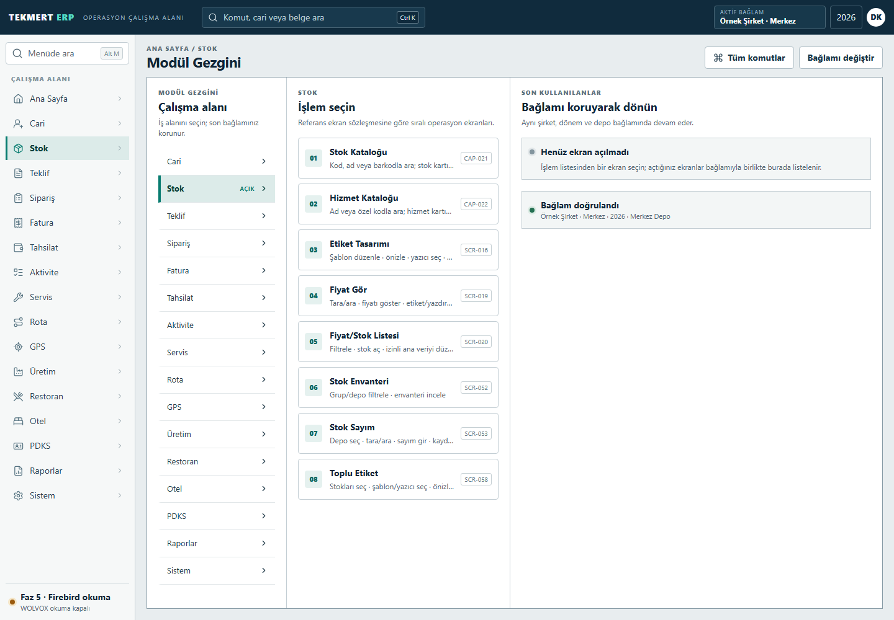
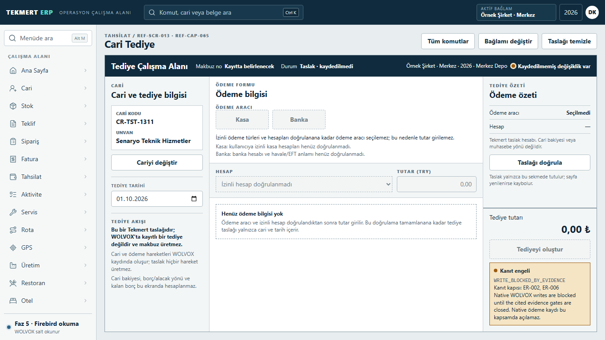
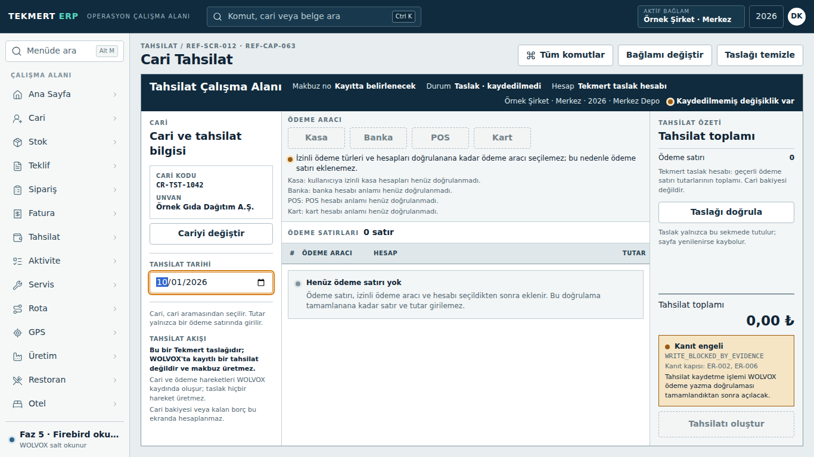
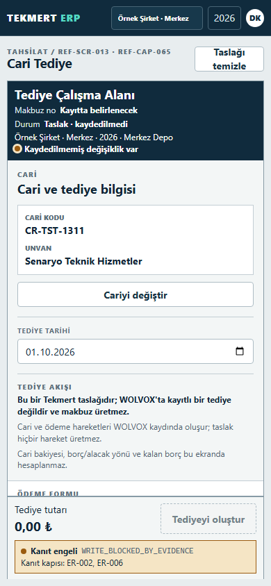

# Tekmert ERP

### A web-first enterprise workbench for ERP-connected business operations

Tekmert ERP is an independently developed business application that brings selected ERP reporting, account lookups, and structured transaction drafts into a consistent browser-based workspace. It is being developed with an explicit separation between application-owned data and the existing ERP system.

**C# / .NET 10 · ASP.NET Core · React · TypeScript · Firebird · SQL Server**

> **Active development, not a production release.** Selected read/report workflows are implemented. Transaction workbenches demonstrate bounded draft entry; native ERP writes remain blocked. This repository contains documentation and synthetic-data screenshots only.

*Actual application capture, 1440 × 1000. Navigation includes roadmap entries; their presence does not mean every module is implemented.*

## Business problem

ERP users need to move between account information, operational reports, and document workflows without losing their company, branch, or accounting-period context. A modern interface must make dense business information readable while avoiding ambiguous actions that could affect financial or operational records.

Replacing the interface is only part of the problem: existing ERP data has its own ownership and business rules. Read access must not silently become permission to create financial transactions.

## Solution

Tekmert provides a module-oriented enterprise workbench with scoped navigation, report surfaces, entity lookups, and transaction drafts. The interface distinguishes available reads from incomplete or blocked operations rather than presenting every visible action as functional.

The application has its own backend and persistence boundary. Selected WOLVOX interoperability is handled through an integration boundary; a draft is not treated as a native ERP transaction.

## Main capabilities

| Area | Implemented scope in the inspected development snapshot |
| --- | --- |
| Application workspace | Module navigation, command palette, company/branch/period context, responsive desktop and mobile layouts |
| Read and report workflows | Eight designated report screens: account balances and statements, quotation and order reports, sales/purchase/expense invoice reports, and a bounded service report |
| Entity discovery | Account, stock, service, and stock-package lookups within their implemented scope |
| Transaction workbenches | Seven designated draft surfaces, including quotations, orders, invoices, collections, and disbursements; native commit remains blocked |
| Collections and disbursements | Account/date selection, validation, discard interactions, and visible write-blocked states; no enabled payment processing or editable payment amount is claimed |

These are development-branch capabilities, not a claim that every feature has shipped to the main branch or passed release acceptance. Remaining modules are roadmap scope.

## Application preview

The following are existing Playwright captures of the actual React application using fictional test fixtures. They are not generated concept images, live customer sessions, or new November test runs. The UI language is Turkish.

### Disbursement workbench — desktop

*1366 × 768. Account and date draft entry are present; payment controls and commit are intentionally disabled. The zero total is not a completed payment.*

Collection workbench and mobile disbursement view

*Collection workbench, 1366 × 768. The empty payment table reflects the current bounded scope, not a hidden completed payment integration.*

*Mobile disbursement view, 390 × 844. The sticky action region retains the explicit blocked status.*

## Technology stack

| Layer | Technologies present in the inspected source |
| --- | --- |
| Backend | C#, .NET 10, ASP.NET Core; modular monolith with explicit module and integration boundaries |
| Frontend | React 19, TypeScript, Vite, Tailwind CSS, Radix UI primitives, a customized enterprise component layer |
| Client state and forms | TanStack Query, React Router, React Hook Form, Zod |
| Application persistence | Microsoft SQL Server with Entity Framework Core |
| ERP interoperability | Firebird provider behind a dedicated boundary for selected read operations; native writes are not enabled |
| Verification | xUnit, integration and architecture tests, Vitest, Testing Library, Playwright, and actual-component Storybook states |

## High-level architecture

| Component | Responsibility |
| --- | --- |
| Browser workbench | Navigation, scoped queries, report presentation, validation, and draft interaction |
| ASP.NET Core host and business modules | Application endpoints, authorization-aware navigation, business contracts, and workflow coordination |
| Application persistence boundary | Storage owned by Tekmert rather than an implicit copy of ERP-owned transaction truth |
| ERP integration boundary | Selected external reads through provider-neutral contracts; unsupported or unverified operations remain closed |

Internal schemas, SQL, endpoint inventories, deployment topology, and security-sensitive configuration are deliberately omitted. [Confidentiality notice](NOTICE.md).

## Engineering challenges

- **ERP data ownership:** keeping application-owned persistence separate from ERP-owned records, without assuming read access establishes safe write semantics.
- **Context isolation:** carrying user/company/branch/period scope through lookups and drafts. Regression coverage exists, but remaining validation failures are not described as solved.
- **Dense operational UI:** preserving readable desktop work surfaces while maintaining mobile task and action hierarchy, rather than stacking every region into generic cards.
- **Honest operation states:** making incomplete payment integration visibly unavailable and keeping synthetic browser evidence separate from real runtime or production acceptance.

## Development status

**Active development / bounded implementation under validation.** The inspected integration branch contains real report and draft implementations. Broad validation is not fully green: the latest inspected source has a failed Windows frontend CI result and cancelled Linux/PR jobs. Historical backend and targeted browser successes do not establish a successful release.

Production deployment, full accessibility acceptance, native-write compatibility, and remaining product acceptance are **not claimed**. See [development and evidence status](docs/project-status.md) for the snapshot date and evidence limits.

## Privacy and source code

The application source repository remains **private**. This public showcase includes only an original English overview, high-level architecture, and visually reviewed synthetic-data screenshots. It contains no proprietary application code, database schemas, internal SQL, customer records, credentials, traces, installers, or deployment configuration.

WOLVOX and other third-party product names identify interoperability context only; this showcase does not imply affiliation or endorsement.

## Developer

**Berke Kırşallıoba**  
Full-Stack .NET Developer

[GitHub](https://github.com/berkekirsallioba) · [LinkedIn](https://www.linkedin.com/in/berkekirsallioba)
